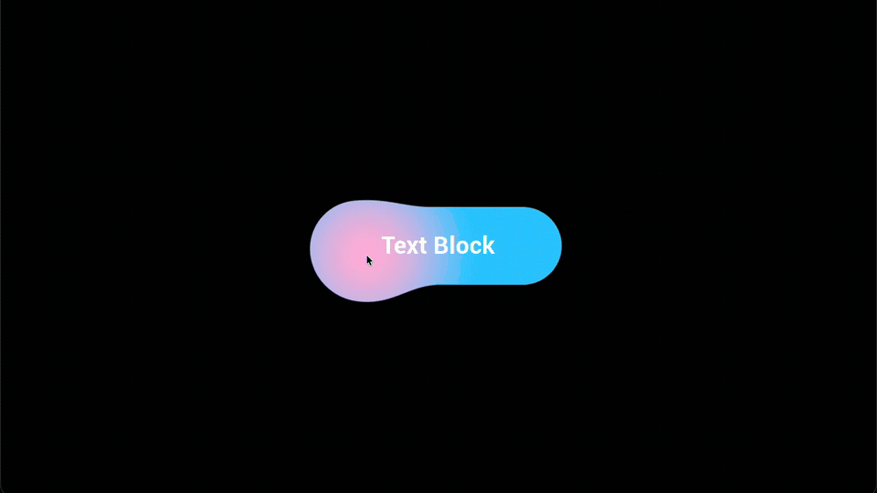
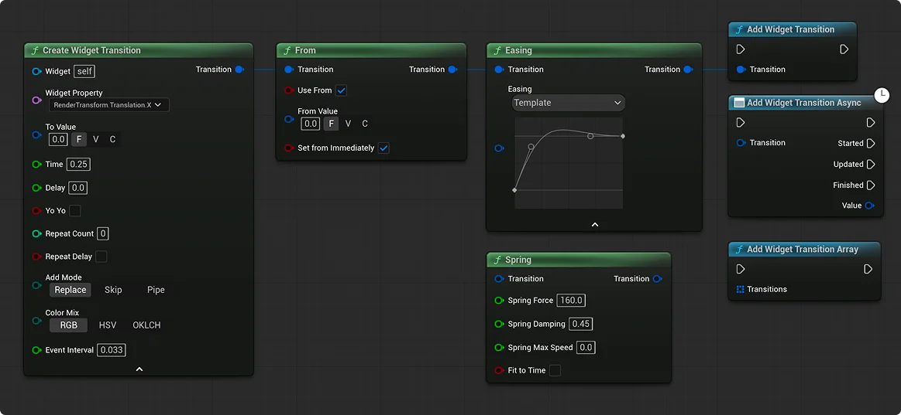
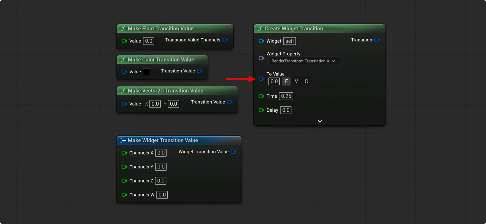

# UMGTransitions

Runtime UMG property transitions for Unreal Engine.



## Concept

UMGTransitions is a procedural animation tool for transitions between two widget states, built on [Material Motion](https://m3.material.io/styles/motion/overview) and [Fluent Motion](https://fluent2.microsoft.design/motion) principles adapted to UMG:

1. Animations are short and do not block user interaction.

2. Animation responds immediately to user input: a new transition replaces the previous one and continues from the current state toward the new target.

3. Animations help explain what appeared, disappeared, changed, or moved in the interface. Animation for its own sake is unnecessary.

4. The primary element animates first, followed by related details.

5. The curve defines the character of the motion.

## How it works

A transition is built with Blueprint nodes and added to the system through `Add Widget Transition`. Each transition is scoped to a specific widget. A transition cannot be added without a valid widget.



1. `Widget Property` binds the transition to a property of the connected widget. Available properties depend on the widget's type, while the base properties `RenderTransform` and `RenderOpacity` are always available. Scalar and vector material parameters are also supported. Set it to `None` for custom counters that use the transition value without a widget-property binding.

2. `From` sets an explicit starting value, such as zero opacity or an off-screen position for an entrance animation. If omitted, the system reads the property's current value when the transition starts.

3. `Easing` controls acceleration and deceleration using a cubic Bézier curve defined by just two control points. Choose a preset or adjust the points manually while preserving the specified transition duration. `Easing` and `Spring` are mutually exclusive: a transition uses one or the other.

4. `Spring` simulates spring motion with inertia and damping. When the target changes, it preserves the current value and velocity so motion continues smoothly and naturally.


5. `Add Mode` determines how a transition is added. `Replace` replaces the current transition, `Skip` yields to the active one and does not start, and `Pipe` queues the transition after the current one. For complex animations, use UMG Animation Editor. Transitions are grouped by property.

6. `ColorMix` selects the color space used to calculate intermediate shades when blending colors: `RGB`, `HSV`, or `OKLCH`.

7. `Event Interval` controls how often the async node fires `Updated` events and properties emit `FieldNotify` notifications.


8. `Transition Value` stores values in a universal four-channel buffer. This lets you control multichannel properties, such as vectors and colors, with a single number. At runtime, the buffer is processed as a vector, allowing vector channels to change naturally.



## C++

The plugin was designed primarily for Blueprint, where UMG interfaces are usually built and widget properties are easier to select and control visually. Transitions can also be created and started from C++ using the builder.

```cpp
#include "WidgetTransitionBuilder.h"

FWidgetTransitionBuilder::Make(this)
    .Target(this, FName(TEXT("RenderOpacity")))
    .To(0.0f)
    .Time(0.25f)
    .Add();
```

## Widget Collection

Widget Collection selects related widgets from the interface hierarchy and
coordinates their transitions into one cohesive animation sequence. The UI
structure defines the group, while shared timing connects individual movements
into a whole.

Inspired by [GSAP Staggers](https://gsap.com/resources/getting-started/Staggers),
launch indices let related elements animate together or follow one another.

For example, a collection of five buttons can use launch indices to appear
simultaneously, one after another, or in groups.

| Function | Purpose |
| --- | --- |
| `CollectWidgets` | Collects a hierarchy in depth-first panel child order. |
| `CollectWidgetsByName` | Collects exact names or case-sensitive Unreal wildcards (`*` and `?`), such as `Item_*`. |
| `MakeWidgetCollection` | Creates a collection from a widget array, skipping invalid references and duplicates. Use a one-element array for one widget. |
| `UnionWidgetCollections` | Combines two collections by widget identity. Preserves first occurrence order, index, and direction; skips invalid references and duplicates. |
| `FilterWidgetCollection` | Keeps listed classes and their subclasses, preserving order, index, and direction. Recalculates local depth; an empty class list returns an empty collection. |
| `ApplyWidgetWave` | Assigns launch indices and directions using the center of `OriginWidget`. |
| `GetWidgetParent` | Returns the direct parent, crossing from a WidgetTree root to its owning User Widget. |

Collections are arrays of `FWidgetCollectionItem`; each item contains:

| Field | Meaning |
| --- | --- |
| `Widget` | Selected widget. |
| `Index` | Zero-based launch index. Widgets sharing an index can launch together. |
| `Depth` | Local hierarchy depth: the number of ancestors present in the output collection. |
| `Direction` | Normalized screen-space direction from the wave origin to the widget; zero before wave calculation. |

Traversal crosses nested User Widgets through their WidgetTree roots. Invalid
source widgets and empty name patterns return empty collections. Name matching
uses `FString::MatchesWildcard` with `ESearchCase::CaseSensitive`.

### Depth selection

`MaxDepth` limits traversal relative to the input root: root is level 0, direct
children are level 1. A negative value removes the limit.

- `bDepthOnly = false`: collects all levels through `MaxDepth`; `bIncludeRoot` controls root inclusion.
- `bDepthOnly = true`: collects only level `MaxDepth`. Level 0 explicitly selects the root; a negative level returns an empty collection.

Every collection-producing function recalculates **local** `Depth` from the
selected widgets, ignoring incoming depth values. Output roots have depth 0;
each selected ancestor adds one level. Unselected intermediate widgets do not
introduce gaps. Selecting a single source level therefore gives depth 0 for every
result. Without root inclusion, direct children also start at local depth 0.

### Waves

`ApplyWidgetWave` replaces each item's `Index` with its distance in grid levels
from `OriginWidget`. Widgets in the same wave share an index and launch together.
Array order stays unchanged.

Available patterns: `Horizontal`, `Vertical`, `Manhattan`, and `Radial`.

`bReverseWave`: edge to origin.

`Direction`: normalized vector from the origin to the widget, unchanged by `bReverseWave`.

## Debug

`DrawDebugCollectionItem` draws a pixel-snapped outline around `Item.Widget`
for `Duration` seconds using `Color`. The label above the outline can show the
object name (`bShowName`), launch index (`bShowIndex`), and local depth
(`bShowDepth`). Index and depth are enabled by default; the name is optional.
Disabled in Shipping and Test builds.

`bColorByIndex` adds a red-to-cold fill ramp. `bColorByDepth` uses the same
deterministic index color and reduces saturation as depth increases, preserving
the hue. The depth mode also applies when both flags are enabled. `IndexOpacity` and `DepthOpacity`
control each fill mode (0–1, default 0.08), scaled by `Color.A`. With both modes
enabled, `DepthOpacity` takes priority. With a color map enabled, the outline
and label background use the map color at full opacity. Colors depend on item values,
so filtering does not rescale the ramp.

## Version support

| Feature | UE 5.1+ | UE 5.0 | UE 4.27 |
| --- | --- | --- | --- |
| Widget property bindings | Supported | Not supported by v2 | Supported |
| Material parameter bindings | Supported | Not supported by v2 | Supported |
| `FieldNotify` notifications | Supported | Not available | Not supported |
| Built-in UMG MVVM | Available | Not available | Not available |
| Branch | `master` (v2) | `release/1.x` | `ue4.27` |

## Performance

Transition storage and runtime scheduling are lightweight for UI animation: 500 eased transitions take 0.053070 ms/frame, about 0.3% of a 16.67 ms frame at 60 FPS. The main incremental cost is cubic Bézier evaluation per transition.

| Case | 10 transitions | 100 transitions | 500 transitions | Complexity |
| --- | ---: | ---: | ---: | --- |
| Linear `RenderOpacity` tick (ms/frame) | 0.000395 | 0.003852 | 0.021689 | O(n) |
| Easing `RenderOpacity` tick (ms/frame) | 0.001015 | 0.010000 | 0.053070 | O(n) |
| Spring `RenderTransform.Translation` tick (ms/frame) | 0.000512 | 0.004914 | 0.035552 | O(n) |
| Custom property tick, reflective binding (ms/frame) | 0.000313 | 0.003413 | 0.021078 | O(n) |
| Spring target update (ms/frame) | 0.000521 | 0.004996 | 0.036666 | O(n) |
| Transition removal, `ClearTransitions` (ms/removal) | 0.000169 | 0.001316 | 0.007057 | O(n) |
| Transition update, `Replace` mode (ms/start) | 0.000749 | 0.003482 | 0.057850 | O(n) |
| Async node, `Updated` every frame (ms/frame) | 0.002959 | 0.032371 | 0.150503 | O(n) |
| Async node, `Updated` with update-frame skipping, 33 ms interval (ms/frame) | 0.001638 | 0.015754 | 0.074650 | O(n) |

## Testing

Run the plugin's editor automation tests with `Automation RunTests UMGTransitions`.
Run collection tests separately with `Automation RunTests UMGTransitions.WidgetCollection`.

| Test group | Coverage | Purpose |
| --- | --- | --- |
| Runtime | Values, binding channels, easing fallback, spring convergence, delay/repeat/YoYo, and add modes | Keeps public transition behavior stable. |
| Callbacks | Started/Updated/Finished values, intervals, cancellation, reentrancy, and `RemoveAtSwap` | Ensures callbacks can safely change transitions. |
| Widget Collection | Traversal, depth-only selection, local depth, wildcard names, union, class filtering, and wave indices | Keeps collection behavior deterministic. |
| Editor | Blueprint node metadata and easing-curve editor integration | Protects Blueprint authoring UX. |
| Diagnostics | Runtime structure layout and storage budgets | Makes memory-layout changes visible. |
| Performance | Tick, easing, springs, custom properties, callbacks, async updates, `ClearTransitions`, and `Replace` | Tracks scaling and regressions at 10/100/500 transitions. |
